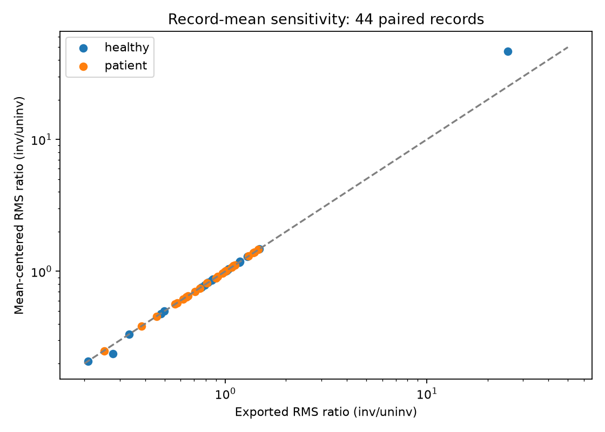

# sEMG limb symmetry after ACL reconstruction: a robustness analysis

How sensitive are descriptive bilateral vastus-lateralis sEMG ratios to amplitude summaries, record-mean removal and controlled measurement perturbations?

The [Dryad dataset](https://doi.org/10.5061/dryad.66t1g1k4j) contains 22 participants and 88 recordings with exported time. This release has no torque, IMU or return-to-sport outcomes. Participants, not samples or repeated tasks, are the independent units.

## Findings

- 13 of 44 participant-condition pairs cross ratio 1 across 21 specifications; 10 cross across the 11 RMS specifications. Small crossings are not clinically important by definition.
- Mean-centering reverses none of the 44 whole-RMS directions. The healthy8/iso90 ratio increases from 25.21 to 46.51; centering does not resolve its denominator problem.
- 23,100 synthetic evaluations show trade-offs: limiting spikes helps against a constructed artefact but also distorts a sustained desired event. Unknown unequal sensor gain persists across methods.

Scientific priority, clinical validity and external validation are not established. Absolute cross-person voltage comparisons are supplemental acquisition-dependent descriptions.



## Reproduce

The full pipeline was tested with **Python 3.14** and `requirements.txt`. The older standard-library inspector is not a compatibility claim for the full dependency set. Place verified original `ACL_data.zip` and `README_acl.txt` in `data/raw/`, install requirements, then:

```powershell
python -m venv .venv
.venv\Scripts\Activate.ps1
python -m pip install -r requirements.txt -r requirements-verification.txt
python scripts/run_all.py
python scripts/run_all.py --verify-delivery
```

The delivery command also builds and locally executes the exact Kaggle notebook with its versioned input bundle. Actual Kaggle execution/publication remains separate. No network is required once source data and dependencies are present. Inside the virtual environment, run `python -m pytest`, `python -m ruff check src scripts tests`, and `python -m ruff format --check src scripts tests`. If PowerShell activation is disabled, use `.venv\Scripts\python.exe` directly in place of `python`.

## Four review documents

Start with the [plain-language case study and three figures](docs/review_case.md).

1. [Methods](docs/review_methods.md)
2. [Results](docs/review_results.md)
3. [Limitations](docs/review_limitations.md)
4. [Portfolio case](docs/review_case.md)

[Baseline signal viewer](reports/analysis_index.html) · [Kaggle instructions](delivery/kaggle/UPLOAD_INSTRUCTIONS.md). Older documents preserve detailed audit history; the four entry points define the current presentation.

`src/` holds reusable analysis; `scripts/` regenerates outputs; `tests/` verifies behaviour; `reports/` contains figures/tables. `docs/history/` preserves earlier reports and source reviews, including their original languages. `data/raw/` preserves measurements. Versioned delivery verification and archived local downloads are generated/local material excluded from Git.

Source data: Gutierrez, Hart and Boukhechba (2022), CC0 per metadata. Original project code/docs: [MIT](docs/CODE_LICENSE.md). Literature and external data retain separate licenses and are excluded from the Kaggle data archive.
