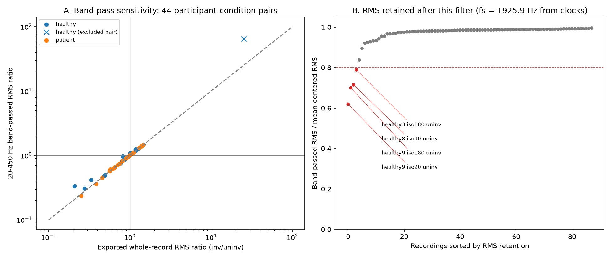

# sEMG limb symmetry after ACL reconstruction: a robustness analysis

**v0.2.0:** the independent ENABL3S methodological extension is ready. Start with the [portfolio case](docs/review_case.md), [cohort findings](docs/enabl3s_cohort_results_v1.md) and [delivery/reproduction guide](delivery/enabl3s/README.md). Code/prose and data-derived artifacts have [separate licenses](DATA_SOURCES.md).

[Download release v0.2.0](https://github.com/victorgomezadapty/acl-semg-robustness/releases/tag/v0.2.0): source/results ZIP, locally executed notebook and verification files. [Publication record](delivery/enabl3s/PUBLICATION.md).

Public Kaggle release: [executed notebook](https://www.kaggle.com/code/vctorandrsgmezlpez/acl-semg-robustness-and-synthetic-scenarios) and [input dataset](https://www.kaggle.com/datasets/vctorandrsgmezlpez/acl-semg-dryad-2022-reproducibility-bundle). The [publication record](delivery/kaggle/PUBLICATION.md) identifies the verified version, environment, component licenses and packaging decisions.

How sensitive are descriptive bilateral vastus-lateralis sEMG ratios to amplitude summaries, record-mean removal, band-pass filtering and controlled measurement perturbations?

The [Dryad dataset](https://doi.org/10.5061/dryad.66t1g1k4j) contains 22 participants and 88 recordings with exported time. This release has no torque, IMU or return-to-sport outcomes. Participants, not samples or repeated tasks, are the independent units.

## Findings

- 13 of the 43 primary participant-condition pairs cross ratio 1 across 21 specifications; 10 cross across the 11 RMS specifications. Small crossings are not clinically important by definition.
- The sampling rate is not stated by the authors but the 88 exported clocks imply average rates of 1,923.9-1,925.9 Hz (median 1,925.9 Hz). A 20-450 Hz band-pass changes the whole-RMS direction in 1 of 43 pairs (patient7/iso180, 0.99 → 1.00) and moves no cohort median ratio by more than 0.05: group medians are relatively stable, while individual ratios can change substantially.
- RMS retention flags four control records with RMS retention of 0.62-0.79 under this filter; it does not diagnose movement artefacts or measure an outside-band energy fraction. These flags trigger review rather than removal; all records remain in sensitivity outputs.
- healthy8/iso90 is excluded from the primary presentation: its uninv record lasts 2.0 s (next shortest: 10.5 s), so its whole-record ratio (25.2 exported, 64.6 band-passed) does not compare like with like. It remains in all sensitivity analyses.
- Mean-centering reverses none of the 44 whole-RMS directions.
- 23,100 synthetic evaluations show trade-offs: limiting spikes helps against a constructed artefact but also distorts a sustained desired event. Unknown unequal sensor gain persists across methods.

Scientific priority and clinical validity are not established. Absolute cross-person voltage comparisons are supplemental acquisition-dependent descriptions. The independent methodological extension below evaluates transport to healthy walking, not clinical validation in ACL reconstruction.

The independent ENABL3S methodological study is complete: one separate [pilot](docs/enabl3s_pilot_review.md), followed by nine participants assessed under fixed rules, six eligible and three excluded. Two of six eligible participants cross ratio 1 across eleven RMS specifications. This is descriptive sensitivity in healthy walking, not a clinical threshold. The [executed ENABL3S Kaggle notebook](https://www.kaggle.com/code/vctorandrsgmezlpez/enabl3s-semg-independent-methods-audit) has its own [dated publication evidence](delivery/enabl3s/KAGGLE_PUBLICATION.md). Clinical validation remains pending.

The [cohort protocol v1](docs/enabl3s_cohort_protocol_v1.md) fixed annotation exclusions, transition margins, minimum segment length and duration/shared-selection sensitivities before the nine-participant analysis. Its original frozen files are preserved.

## Portfolio and research update

The [visual case study](portfolio/dist/index.html) presents the question, interactive participant-level results, decisions, limitations and next research steps. Rebuild its data and figures with `python scripts/build_portfolio.py`; the page works as a static site without a build toolchain.

The [critical literature update](docs/literature_update_2026-10-18.md), [search log](docs/literature_search_2026-10-18.csv) and [evidence matrix](docs/literature_evidence_2026-10-18.csv) distinguish published evidence, inspected datasets and proposed extensions. This is a targeted review, not an exhaustive systematic review or proof of novelty.



## Reproduce

Read the [step-by-step reproduction guide](docs/reproducibility.md) and the [decision record: choices, reasons and alternatives](docs/decision_log.md). They include data hashes, environment setup, expected outputs, troubleshooting and adaptation requirements.

The full pipeline was tested with **Python 3.14** and `requirements.txt`. The older standard-library inspector is not a compatibility claim for the full dependency set. Place verified original `ACL_data.zip` and `README_acl.txt` in `data/raw/`, install requirements, then:

```powershell
python -m venv .venv
.venv\Scripts\Activate.ps1
python -m pip install -r requirements.txt -r requirements-verification.txt
python scripts/run_all.py
python scripts/run_all.py --verify-delivery
```

The delivery command also builds and locally executes the exact Kaggle notebook with its versioned input bundle. Actual Kaggle execution/publication remains separate. No network is required once source data and dependencies are present. Inside the virtual environment, run `python -m pytest`, `python -m ruff check src scripts tests`, and `python -m ruff format --check src scripts tests`. If PowerShell activation is disabled, use `.venv\Scripts\python.exe` directly in place of `python`. When the project lives in a synced folder such as OneDrive, create the environment outside it (for example `%USERPROFILE%\.venvs\acl-semg`) so thousands of package files are not synchronized.

## Four review documents

Start with the [plain-language case study and four figures](docs/review_case.md). Changes and their reasons are listed in the [changelog](CHANGELOG.md).

1. [Methods](docs/review_methods.md)
2. [Results](docs/review_results.md)
3. [Limitations](docs/review_limitations.md)
4. [Portfolio case](docs/review_case.md)

[Baseline signal viewer](reports/analysis_index.html) · [Kaggle instructions](delivery/kaggle/UPLOAD_INSTRUCTIONS.md). Older documents preserve detailed audit history; the four entry points define the current presentation.

`src/` holds reusable analysis; `scripts/` regenerates outputs; `tests/` verifies behaviour; `reports/` contains figures/tables. `docs/history/` preserves earlier reports and source reviews, including their original languages. `data/raw/` preserves measurements. Versioned delivery verification and archived local downloads are generated/local material excluded from Git.

Source data: Gutierrez, Hart and Boukhechba (2022), CC0 per metadata. Original project code/docs: [MIT](docs/CODE_LICENSE.md). Literature and external data retain separate licenses and are excluded from the Kaggle data archive.
