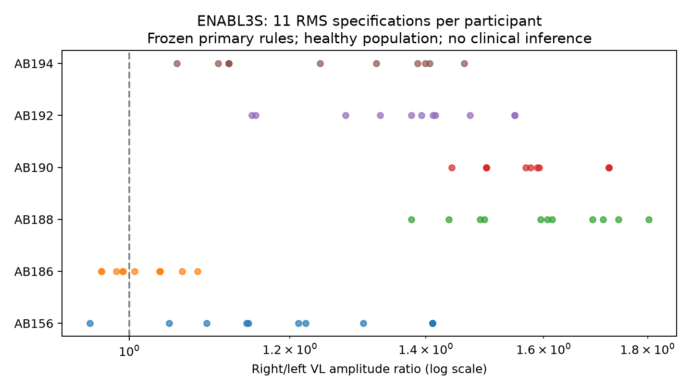

# ENABL3S: ejecución de los nueve participantes restantes

2026-10-09 · Análisis secundario de métodos en personas sanas. AB191 se mantiene como piloto separado. No es validación clínica de reconstrucción de LCA ni demostración de novedad científica.

[Protocolo v1](enabl3s_cohort_protocol_v1.md) · [integridad de los nueve ZIP](../reports/enabl3s_cohort_download_manifest.json) · [resultados y auditoría completos](../reports/enabl3s_cohort_results_v1.json) · [tabla principal](../reports/enabl3s_cohort_primary_v1.csv).

Fuente: Hu, Rouse y Hargrove, [ENABL3S v2](https://doi.org/10.6084/m9.figshare.5362627.v2), CC BY 4.0. Se conservaron los originales; se usó Processed sin filtrado adicional ni conversión de unidades. Las notas vacías no certifican ausencia de artefactos. La configuración y los archivos congelados se verificaron por SHA-256 antes del cálculo.

## Flujo de participantes

De nueve participantes: 6 tienen un tramo elegible, 3 están excluidos y 0 presentan un error que impide el cálculo. De los elegibles, 6 tienen las once razones positivas y finitas del principal.

| Participante | Estado principal | Duración útil (s) | Rango de log-razones | Cruce de 1 |
|---|---|---:|---:|---|
| AB156 | complete | 5.810 | 0.3884 | True |
| AB185 | excluded: no_eligible_trial_or_segment | n/a | n/a | n/a |
| AB186 | complete | 4.910 | 0.1091 | True |
| AB188 | complete | 5.360 | 0.2691 | False |
| AB189 | excluded: no_eligible_trial_or_segment | n/a | n/a | n/a |
| AB190 | complete | 4.190 | 0.1787 | False |
| AB192 | complete | 5.480 | 0.2980 | False |
| AB193 | excluded: no_eligible_trial_or_segment | n/a | n/a | n/a |
| AB194 | complete | 4.100 | 0.3255 | False |

Entre los 6 principales completos, mediana del rango de log-razones: **0.2835** (mínimo 0.1091; máximo 0.3884). 2 cruzan 1 entre métodos. El rango no es un intervalo de confianza y un cruce pequeño no establece importancia clínica.

## Sensibilidades y casos no calculables

Cada margen alternativo se aplicó al mismo tramo original, sin buscar otro para aumentar la muestra. La tabla distingue resultados completos, parciales y segmentos demasiado cortos. La diferencia emparejada de rango se calcula solo en participantes con ambos rangos completos; no compara medianas de muestras distintas.

| Margen (ms) | Familia | Selección | Completos | Parciales | No disponibles | Diferencia mediana vs principal (n emparejado) |
|---:|---|---|---:|---:|---:|---|
| 250 | original_samples | independent | 6 | 0 | 0 | +0.0849 (n=6) |
| 250 | original_samples | shared_intersection | 5 | 1 | 0 | +0.3280 (n=5) |
| 250 | time_matched | independent | 6 | 0 | 0 | +0.0053 (n=6) |
| 250 | time_matched | shared_intersection | 5 | 1 | 0 | +0.0971 (n=5) |
| 500 | original_samples | independent | 6 | 0 | 0 | +0.0000 (n=6) |
| 500 | original_samples | shared_intersection | 4 | 2 | 0 | +0.1488 (n=4) |
| 500 | time_matched | independent | 6 | 0 | 0 | +0.0269 (n=6) |
| 500 | time_matched | shared_intersection | 5 | 1 | 0 | +0.0205 (n=5) |
| 1000 | original_samples | independent | 3 | 0 | 3 | -0.0218 (n=3) |
| 1000 | original_samples | shared_intersection | 2 | 1 | 3 | +0.4187 (n=2) |
| 1000 | time_matched | independent | 3 | 0 | 3 | +0.0064 (n=3) |
| 1000 | time_matched | shared_intersection | 3 | 0 | 3 | +0.1333 (n=3) |

## Registro de exclusiones

- **AB156**: {"selected_first_eligible_run": 1}; 49 ensayos posteriores no evaluados porque la selección determinista ya terminó. Textos de notas, archivos e índices constan en el JSON completo.
- **AB185**: {"no_contiguous_walk_meeting_guard_and_length": 49, "nonempty_or_missing_notes": 3}; 0 ensayos posteriores no evaluados porque la selección determinista ya terminó. Textos de notas, archivos e índices constan en el JSON completo.
- **AB186**: {"selected_first_eligible_run": 1}; 43 ensayos posteriores no evaluados porque la selección determinista ya terminó. Textos de notas, archivos e índices constan en el JSON completo.
- **AB188**: {"selected_first_eligible_run": 1}; 39 ensayos posteriores no evaluados porque la selección determinista ya terminó. Textos de notas, archivos e índices constan en el JSON completo.
- **AB189**: {"no_contiguous_walk_meeting_guard_and_length": 45, "nonempty_or_missing_notes": 4}; 0 ensayos posteriores no evaluados porque la selección determinista ya terminó. Textos de notas, archivos e índices constan en el JSON completo.
- **AB190**: {"selected_first_eligible_run": 1}; 48 ensayos posteriores no evaluados porque la selección determinista ya terminó. Textos de notas, archivos e índices constan en el JSON completo.
- **AB192**: {"selected_first_eligible_run": 1}; 47 ensayos posteriores no evaluados porque la selección determinista ya terminó. Textos de notas, archivos e índices constan en el JSON completo.
- **AB193**: {"no_contiguous_walk_meeting_guard_and_length": 48, "nonempty_or_missing_notes": 2}; 0 ensayos posteriores no evaluados porque la selección determinista ya terminó. Textos de notas, archivos e índices constan en el JSON completo.
- **AB194**: {"no_contiguous_walk_meeting_guard_and_length": 35, "nonempty_or_missing_notes": 6, "selected_first_eligible_run": 1}; 8 ensayos posteriores no evaluados porque la selección determinista ya terminó. Textos de notas, archivos e índices constan en el JSON completo.

## Interpretación y reproducción

Las diferencias describen dependencia del algoritmo y la ventana elegida. No identifican qué método es fisiológicamente correcto. La selección compartida puede privilegiar coactivación; las ventanas de duración equivalente no igualan tarea, fase de marcha, sensores o procesamiento con Dryad. No se combinan sujetos, bloques o ensayos como unidades independientes ni se infieren fuerza o retorno al deporte.

El análisis conserva amplitudes de numerador/denominador, colas descartadas e índices de selección. Variantes sin intersección, con denominador no positivo o con rango incompleto se mantienen con motivo explícito. Las razones se interpretan como cocientes de unidades de exportación; no eliminan posibles diferencias de ganancia o normalización bilateral.

```powershell
.\.venv\Scripts\python.exe scripts/fetch_enabl3s_cohort.py
.\.venv\Scripts\python.exe scripts/analyze_enabl3s_cohort.py
.\.venv\Scripts\python.exe scripts/report_enabl3s_cohort.py
```

La descarga requiere Internet; el análisis es local una vez verificados los originales. Esta extensión no actualiza automáticamente Kaggle.


