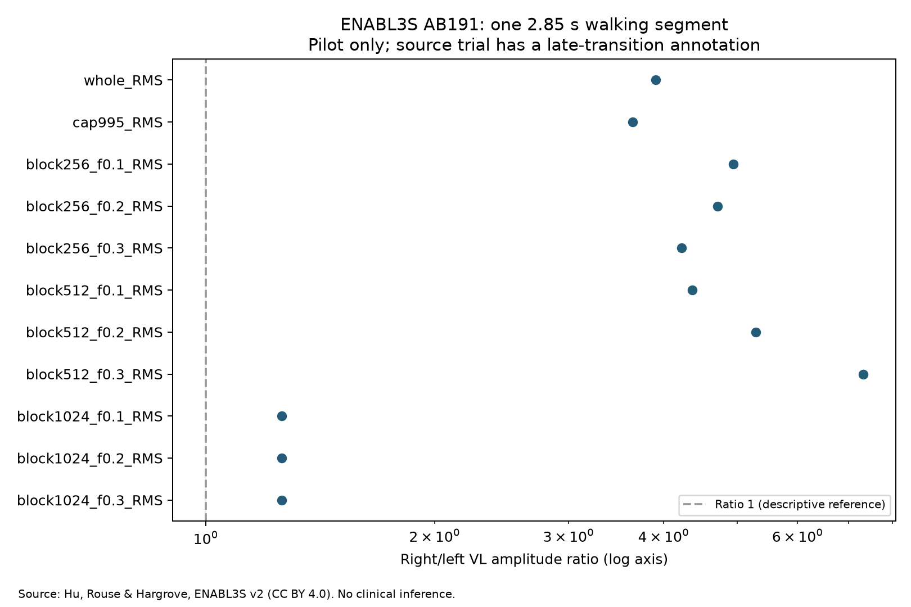

# Segunda fase: piloto independiente ENABL3S

Actualización 2026-10-08: las reglas para los nueve participantes restantes están definidas en el [protocolo de cohorte v1](enabl3s_cohort_protocol_v1.md). Esta actualización no cambia el piloto descrito abajo.

2026-10-07. **Se completó un piloto metodológico de un participante sano. La validación clínica y el análisis de los diez participantes siguen pendientes.** El notebook publicado en Kaggle ya corresponde a la primera entrega.

## Pregunta, datos y decisiones

Se estudió si las mismas 11 especificaciones RMS producen resultados diferentes en otra fuente. El [protocolo](history/enabl3s_transport_protocol.md) se escribió antes de abrir valores. AB191 se eligió por tener el ZIP de menor tamaño, no por su resultado. Fuente: Hu, Rouse y Hargrove, [ENABL3S v2](https://doi.org/10.6084/m9.figshare.5362627.v2), CC BY 4.0; [métodos publicados](https://doi.org/10.3389/frobt.2018.00014).

El ZIP coincide con tamaño y MD5 de Figshare; SHA-256 propio: `c7608026950e6f4c15f2279966377ab9cdf7409125486beeac8612af13330013`. Su [inventario](../reports/enabl3s_pilot_inventory.json) contiene 99 miembros. Se leyó la carpeta Processed, no se atribuyó a sus valores una unidad física no confirmada y no se añadió filtrado.

Se eligió el primer segmento continuo etiquetado como marcha en llano con al menos 2.048 muestras válidas: `AB191_Circuit_001_post.csv`, filas numéricas [8280, 11130), índices desde cero y extremo final excluido. Son 2.850 muestras, equivalentes a 2,85 s con los 1.000 Hz documentados. La nota del ensayo dice «Late transition from LW to SA». Es una advertencia sobre el ensayo; no permite localizar por sí sola el error ni demostrar contaminación del segmento seleccionado. Se mantuvo el segmento según la regla previa, sin cambiarlo tras observar los resultados.

## Resultado del piloto

Las 11 variantes están definidas. RMS completo: **3,9034**; límite p99,5: **3,6441**. El mínimo entre métodos es **1,2583** y el máximo **7,3128**; rango de log-razones: **1,7598**. Ninguna variante cruza 1. La derecha es el numerador por convención; no es un miembro operado. Estos valores no miden déficit de fuerza ni permiten diagnosticar asimetría patológica.



Todos los resultados y amplitudes de numerador/denominador están en [enabl3s_pilot_results.json](../reports/enabl3s_pilot_results.json).

## Qué aporta la inspección adicional

Después de calcular el resultado se añadió una auditoría explicativa de los bloques seleccionados. **Es una inspección posterior, no un endpoint nuevo definido previamente.** No se modificó el algoritmo ni el segmento.

| Bloque | Bloques completos | Muestras finales descartadas | Consecuencia observable |
|---|---:|---:|---|
| 256 muestras | 11 | 34 | Cada lado puede seleccionar bloques distintos. |
| 512 muestras | 5 | 290 | Con factor 0,3, derecha selecciona el bloque 4 e izquierda los bloques 1, 3 y 4; la razón resulta 7,3128. |
| 1.024 muestras | 2 | 802 | Ambos lados seleccionan solo el bloque 1 con los tres umbrales; la razón es 1,2583 en los tres casos. |

Esto muestra por qué no basta con informar una razón final: hay que documentar duración, colas descartadas y qué instantes aporta cada lado. Con 1.024 muestras se descarta el 28,1 % del segmento. Los bloques tienen duraciones mayores que en Dryad; no se puede comparar directamente el rango observado con el de sus tareas isométricas. La nota de transición, la fase de marcha, el procesamiento y el escalado de sensores son explicaciones posibles que este piloto no separa causalmente.

## Reproducir y continuar

Desde la raíz, con el entorno existente:

```powershell
.\.venv\Scripts\python.exe scripts/fetch_enabl3s_pilot.py
.\.venv\Scripts\python.exe scripts/analyze_enabl3s_pilot.py
```

El primer comando requiere acceso a Internet si no están los originales. Descarga por rangos reanudables y verifica el ZIP completo. El segundo vuelve a verificar SHA-256 y genera resultados y gráfico sin modificar los originales. El código usa las dependencias existentes. Se añadieron tres pruebas de segmentación; las 17 pruebas del proyecto pasan.

Antes de extenderlo a los otros nueve participantes, la revisión debe decidir cómo tratar anotaciones de transición y si interesa una evaluación separada con ventanas de igual duración y selección temporal compartida. Cualquier nueva regla deberá escribirse antes de inspeccionar esos resultados y mantener este piloto como resultado exploratorio. No se ha actualizado la publicación de Kaggle con esta segunda fase ni se ha demostrado novedad científica o utilidad clínica.
