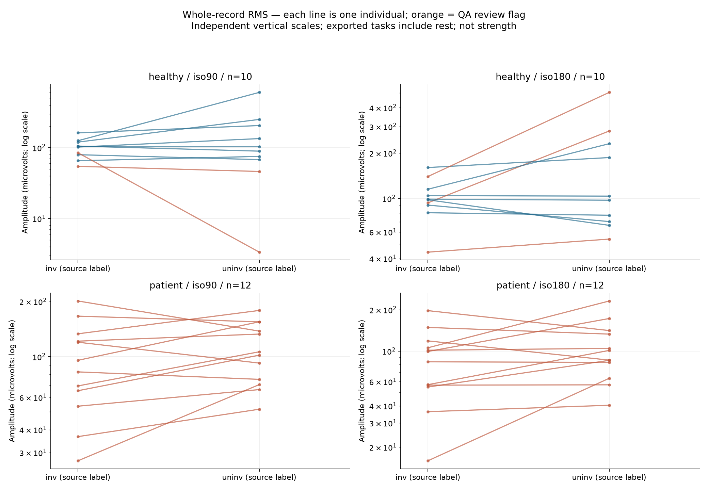
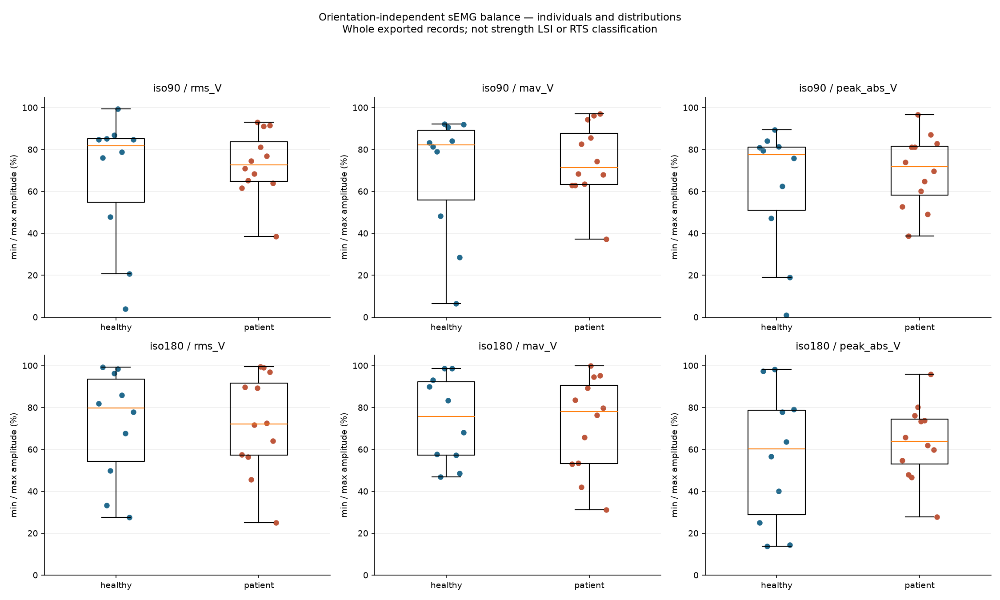
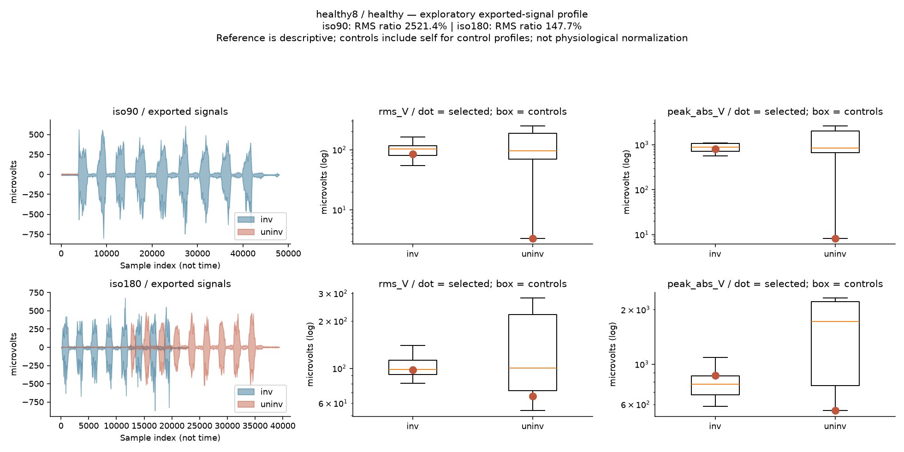
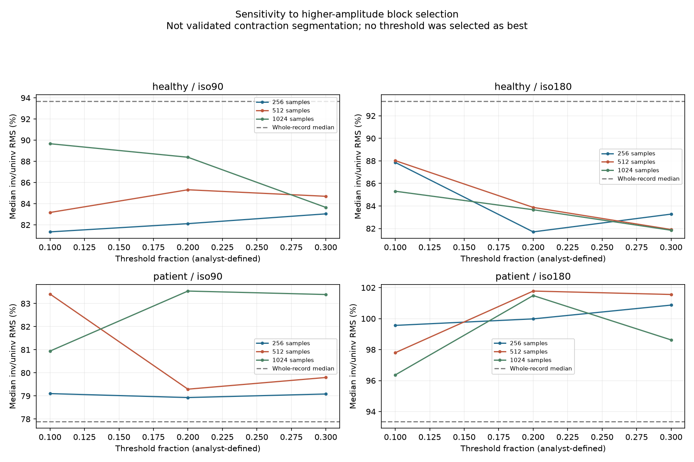
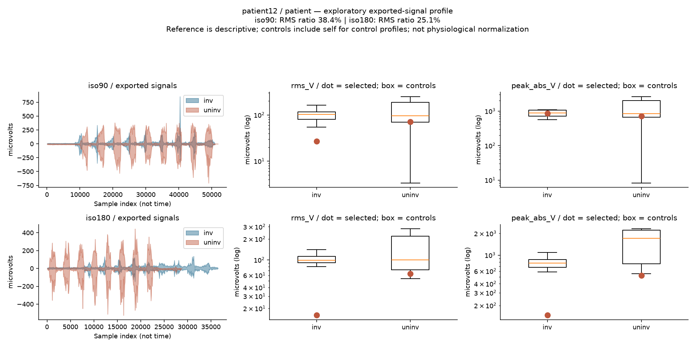

# ACL Rehabilitation Analytics: de la señal a una conclusión defendible

Caso de portfolio · 6 de octubre de 2026 · Fisioterapia y análisis de datos

## Pregunta

¿Cómo varían la amplitud y la simetría de la sEMG exportada del vasto lateral entre miembros, condiciones y participantes después de reconstrucción de LCA, y cuánto dependen los resultados de las decisiones analíticas?

## Datos y enfoque

Dataset público [Dryad, 2022](https://doi.org/10.5061/dryad.66t1g1k4j): 12 pacientes, 10 controles, dos condiciones originales (iso90/iso180), dos miembros y 88 registros. Los archivos contienen sEMG en voltios y tiempo; los datos de fuerza y de IMU descritos en el contexto del estudio no están incluidos en este paquete.

Se verificaron hashes, estructura, unidades, padding y relojes. Se conservaron todas las personas en el análisis principal. Se calcularon RMS, MAV y picos, ambos miembros en valores absolutos, cociente inv/uninv y balance min/max. La unidad independiente es la persona. Los intervalos bootstrap, efectos y ajustes de Holm acompañan comparaciones exploratorias. No se eligieron métodos para obtener significación o reproducir cifras publicadas.

## Cinco gráficos para presentar el caso

### 1. Amplitud absoluta antes de interpretar simetría

Cada par conserva los valores de ambos miembros. Un cociente similar puede surgir de amplitudes absolutas diferentes. Sin normalización MVC ni configuración completa del procesamiento, estas magnitudes describen registros exportados y no activación fisiológica comparable entre personas.

### 2. Distribución individual del balance

Min/max ×100 evita que invertir etiquetas produzca cocientes superiores a 100, pero pierde la dirección de la diferencia. Se presenta junto al cociente dirigido, nunca como porcentaje de fuerza recuperada ni umbral de alta deportiva. La dispersión individual impide reducir el caso a una sola media.

### 3. Una señal corta puede dominar la media de cocientes

El registro healthy8/iso90/uninv contiene 3.848 muestras y una amplitud pequeña. La media del cociente RMS en controles iso90 es 328,56%; al omitir ese par únicamente como sensibilidad, pasa a 84,91%. La mediana cambia de 93,7% a 86,8%. Esto ilustra un denominador pequeño, no una razón para eliminar retrospectivamente al participante del análisis principal.

### 4. La agregación cambia el resultado

Tres tamaños de bloque y tres umbrales permiten observar dependencia de la selección de amplitud. Son 792 variantes por registro y 36 resúmenes de cohorte-condición. Esta selección matemática no recupera contracciones validadas ni constituye un protocolo óptimo. La sensibilidad a picos también es material: limitar al percentil 99,5 reduce RMS alrededor de 29,1% en healthy3/iso180/uninv.

### 5. El perfil individual mantiene el contexto

Se muestran ambas condiciones, señales y medidas absolutas. El pico de patient12/iso90/inv afecta RMS: la reducción al limitar extremos es aproximadamente 15%. No se determina si el transitorio es artefacto. El [visor](../../reports/analysis_index.html) permite consultar los 22 perfiles.

## Qué podemos concluir

### Aportación adicional evaluada

La [matriz de sensibilidad](robustness_results.md) muestra 13 de 44 pares participante-condición con cambio de dirección entre 21 especificaciones; 10 cambian al restringirse a variantes RMS. Las pruebas sintéticas verifican ganancia común, reposo desigual, un transitorio y un denominador pequeño. Esto agrega una auditoría de dependencia del método al cociente único, sin validar su relevancia clínica ni afirmar que el método de sensibilidad sea nuevo en la literatura.

Las medianas RMS inv/uninv en pacientes son 77,9% en iso90 y 93,3% en iso180. Son descriptivos de estos registros; no prueban que una velocidad detecte más déficit. Ninguna de las 60 comparaciones mantiene p <0,05 tras Holm dentro de su familia, tanto con tests t como de rangos. Esto no demuestra equivalencia, ausencia de diferencias ni potencia suficiente.

El hallazgo principal del portfolio es metodológico: la calidad del denominador, la selección del registro y la ponderación de picos alteran las medidas de simetría. Por ello, el producto conserva señales, amplitudes absolutas, distribuciones y sensibilidad junto a los cocientes.

## Comparación con la reutilización publicada

El [artículo secundario de 2026](https://doi.org/10.25259/JMSR_129_2026) reporta RMS y picos durante contracciones. Nuestros cocientes de registro completo no coinciden exactamente. La tabla íntegra está en [resultados](comprehensive_results.md).

La influencia del registro corto en nuestra media de controles está demostrada por sensibilidad. Las diferencias de límites de contracción, procesamiento y normalización son explicaciones posibles, no causas confirmadas de la discrepancia con el artículo. No tenemos decisiones reproducibles suficientes para atribuirla a una causa única o afirmar que la publicación es incorrecta.

## Límites y aportación profesional

No hay torque, otras señales musculares, IMU, visitas longitudinales ni desenlaces clínicos. Los relojes involucrados de pacientes tienen tiempos duplicados; no se repararon ni se hicieron inferencias temporales a partir de ellos. La lateralidad de controles y el procesamiento de exportación están incompletamente documentados. Con 22 personas, los resultados son exploratorios.

El proyecto demuestra auditoría de datos, integración de literatura, definición transparente de métricas, análisis pareado, incertidumbre y comunicación clínica prudente. No produce una regla de retorno al deporte.

## Entrega reproducible y siguiente etapa

[README y comandos](../../README.md), [métodos](comprehensive_methods.md), [tablas y resultados](comprehensive_results.md), [literatura](literature_review.md) y [visor individual](../../reports/analysis_index.html) acompañan este caso. La propuesta de extensión y las fuentes candidatas están en [extension_plan.md](extension_plan.md).
