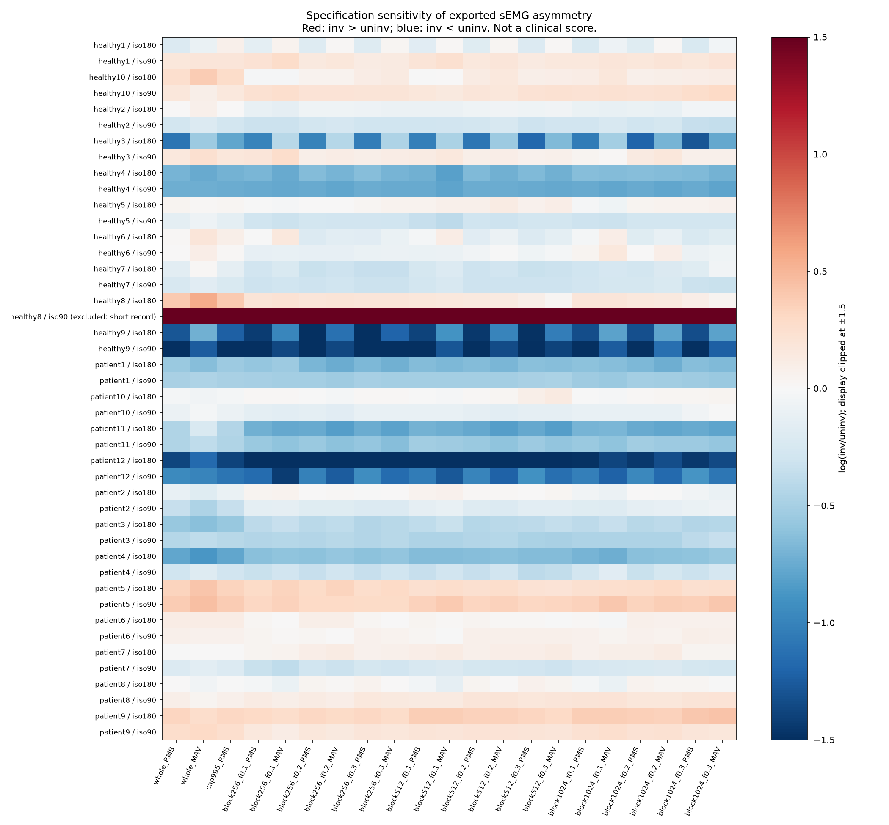

# Aportación evaluada: sensibilidad de la interpretación

Evaluación retrospectiva · 2026-10-06. No es un descubrimiento clínico ni se afirma prioridad científica.

## Resultado principal

De 44 pares participante-condición, **13 (29.5%) cambian de dirección** entre las 21 especificaciones de amplitud. Corresponden a 11 de 22 personas; cada persona puede aportar dos condiciones. Cambiar de dirección significa que unas especificaciones dan inv/uninv <1 y otras >1. Diferencias muy pequeñas también cuentan: no implica un cambio clínicamente relevante.

Esto demuestra información adicional al RMS único: identifica interpretaciones dependientes de cómo se resume la señal. No demuestra cuál especificación es fisiológicamente correcta. Las 21 variantes no son réplicas independientes ni votos con probabilidad clínica. RMS y MAV son estimandos diferentes; se agrupan aquí para mostrar dependencia de la interpretación, no para estimar error de medición del mismo estimando.

Clasificación de validez (2026-10-07): 1 par(es) quedan fuera de la presentación principal porque un miembro dura menos del 25% de la mediana de su cohorte-condición; con los 43 pares válidos, 13 cambian de dirección (21 variantes) y 10 con las 11 variantes RMS. Los 44 se conservan como sensibilidad.

Si se restringe la comparación a las 11 variantes RMS (registro completo, límite de picos y nueve selecciones de bloques), 10 pares cambian de dirección. Los bloques seleccionados siguen midiendo subconjuntos diferentes del registro.

Ejemplos auditables: healthy1/iso180 abarca aproximadamente 79,5–107,7% entre especificaciones; patient2/iso180, 83,6–106,0%. En cambio, patient6/iso90 abarca 99,6–108,7%: cruzar 100% por sí solo no indica una diferencia sustancial. Los valores no describen fuerza muscular recuperada.

## Evaluación con perturbaciones conocidas

Se generó una señal aleatoria con semilla fija y una copia de amplitud 0,8. Las 21 especificaciones recuperan 0,8 y conservan el cociente bajo ganancia común ×7. Añadir reposo exclusivamente a inv cambia el RMS total a 0,4 sin cambiar la amplitud activa subyacente. Un transitorio artificial invierte la dirección del RMS; la sensibilidad al límite p99,5 mantiene la dirección original. Reducir el denominador ×0,01 produce cociente 80: el análisis lo expone, pero no lo corrige automáticamente ni diagnostica su causa.

Estas comprobaciones pasaron por assertions y prueban propiedades matemáticas de casos construidos. No validan segmentación, artefactos reales, fuerza ni recuperación. Los bloques se seleccionan por separado en cada miembro, sin sincronización fisiológica.

## Protocolo y utilidad demostrada

La formalización PICOTT posterior fija el rango logarítmico entre las 11 variantes RMS como resultado principal de la evaluación externa propuesta. El rango de las 21 variantes aquí exportado corresponde al desarrollo retrospectivo; no se presenta como análisis preregistrado. Los cambios de signo quedan como resultado secundario y no establecen importancia clínica.

Tres resúmenes completos (RMS, MAV, RMS limitado p99,5) más 18 variantes de bloque (3 tamaños ×3 umbrales ×2 métricas). Se conservan los 88 registros y todas las variantes. La utilidad demostrada es **auditar la estabilidad de la dirección y magnitud de una interpretación descriptiva**, con tabla por persona y señal consultable. No se usa umbral 90%, p-value ni criterio de retorno deportivo.

La auditoría amplía el análisis estándar del dataset; para afirmar novedad bibliográfica hace falta una búsqueda específica de estudios multiverse/specification-curve y robustez sEMG. Para afirmar utilidad clínica hace falta validación independiente y desenlaces observados. No se añaden inferencias de grupo seleccionando la especificación más favorable.

La revisión dirigida localizó [Simonsohn, Simmons y Nelson (2020)](https://doi.org/10.1038/s41562-020-0912-z), antecedente de specification curve analysis. La idea de evaluar decisiones alternativas ya existe. Este proyecto adapta una auditoría descriptiva a estos registros y no ejecuta el procedimiento inferencial completo de ese artículo.

## Entregables y reproducción

- [924 resultados de especificación](../../reports/robustness_specifications.csv).
- [44 resúmenes por participante-condición](../../reports/robustness_participant_summary.csv).
- [105 resultados sintéticos](../../reports/robustness_synthetic_checks.csv).
- Código: scripts/evaluate_robustness.py, después de comprehensive_semg.py.

No hay validación independiente ni ejecución confirmada en Kaggle todavía. El paquete preparado contiene datos originales atribuidos, código y notebook que regenera los análisis.
