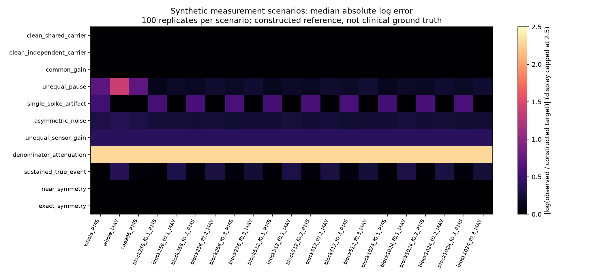

# Estudio de escenarios sintéticos para revisión

2026-10-06. Experimento computacional exploratorio, realizado después del análisis Dryad. Resultados propios reproducibles; no preregistrado y sin afirmación de prioridad científica.

## Pregunta y aportación

¿Qué perturbaciones conocidas distorsionan el cociente bilateral y qué compromisos introducen las 21 especificaciones existentes? La aportación adicional es un banco de escenarios con referencia construida, errores cuantificados y casos donde una corrección útil también puede eliminar señal deseada. Complementa los [resultados reales](robustness_results.md) y la [revisión de antecedentes](scientific_novelty_review.md).

## Métodos reproducibles

Ejecutar `python scripts/simulate_measurement_scenarios.py` desde la raíz. [Código](../../scripts/simulate_measurement_scenarios.py), [resultados individuales](../../reports/synthetic_scenario_results.csv), [resumen](../../reports/synthetic_scenario_summary.csv), [comprobaciones](../../reports/synthetic_scenario_checks.json).

Se generaron 100 realizaciones por cada uno de 11 escenarios, con semillas 2026100600–2026100699 y 16.384 muestras activas. Portadora gaussiana de media cero; envolvente constante por bloques de 1.024 muestras, con amplitud uniforme entre 0,3 y 1,7. El par básico comparte portadora y tiene cociente 0,8. Un control adicional usa portadoras independientes y calibra su RMS para conservar ese cociente. No se asigna frecuencia de muestreo: no se simulan espectro fisiológico, unidades motoras ni adquisición clínica.

Se aplican sin ajuste posterior las 21 especificaciones ya usadas: RMS y MAV completos, RMS limitado a p99,5 y RMS/MAV de bloques de 256/512/1024 muestras, seleccionados por tres umbrales relativos. Cada lado se selecciona por separado. Las 11 variantes RMS pueden filtrarse por el nombre del método en los CSV.

Escenarios: control limpio compartido, control limpio independiente, ganancia común ×7, pausas añadidas únicamente al numerador (tres veces su longitud activa), artefacto de una muestra (+150), ruido gaussiano añadido al numerador (desviación 0,8), ganancia del sensor numerador ×1,5, atenuación del denominador ×0,1, evento elevado sostenido ×8 durante 1.024 muestras, casi simetría (1,001) y simetría exacta (1).

La referencia es el cociente RMS **antes de las perturbaciones de medición**, excepto en el evento sostenido: allí la elevación se define como señal deseada y la referencia incluye el evento. No se deduce esta intención a partir de los datos; se conoce porque se construye el escenario. La referencia es un objetivo matemático, no una etiqueta clínica.

Se informa error absoluto `|log(cociente observado / referencia)|`, mediana, percentil 90 y fracción de cambios de dirección frente a la referencia. Los cuantiles describen variabilidad simulada, no intervalos clínicos ni incertidumbre sobre pacientes. Los métodos de selección y MAV pueden medir estimandos distintos; su diferencia respecto al RMS de referencia no demuestra que sean fisiológicamente incorrectos. No hay pruebas de significación ni selección de un ganador universal.

## Resultados

11 escenarios × 100 realizaciones × 21 métodos = **23.100 evaluaciones**. Las comprobaciones algebraicas de invariancia y cocientes previstos pasaron.

| Escenario | Resultado observado | Interpretación limitada al escenario |
|---|---|---|
| Ganancia común | Los 21 métodos conservan el cociente 0,8 | Cambiar ambos lados por el mismo factor no cambia estos cocientes. |
| Pausa desigual | RMS completo baja de 0,8 a 0,4; error logarítmico 0,693. Bloques 1024/f0,2: mediana 0,168 | Seleccionar bloques reduce la distorsión aquí, pero no recupera exactamente el objetivo: cambia la envolvente seleccionada. |
| Pico artificial | RMS completo invierte dirección en 100/100; RMS limitado en 0/100. Error mediano 0,528 frente a 0,000402 | Limitar picos ayuda frente al artefacto construido; seleccionar bloques de alta amplitud puede conservarlo. |
| Ruido desigual | RMS completo y limitado invierten dirección en 100/100; bloques 1024/f0,2 en 73/100 | Recortar picos no resuelve ruido aditivo sostenido. |
| Ganancia desigual | Todos los métodos dan 1,2 en lugar de 0,8 | La selección no identifica ni corrige una diferencia desconocida de calibración. |
| Denominador atenuado | Todos los métodos dan 8 en lugar de 0,8 | Un cociente grande puede provenir del escalado del denominador. |
| Evento sostenido deseado | RMS completo conserva la referencia; RMS limitado tiene error mediano 0,0441; bloques 1024/f0,2 cambian dirección en 5/100 | Una operación útil contra artefactos puede distorsionar señal que se desea preservar. |
| Simetría y casi simetría compartidas | Todos los métodos conservan 1 y 1,001 | Son controles matemáticos favorables; no evalúan incertidumbre alrededor de la simetría con portadoras independientes. |

## Qué añade y qué no permite concluir

El entregable añade al análisis observacional una referencia conocida y evidencia computacional de compromisos entre conservación de señal y resistencia a perturbaciones. Ofrece casos de fallo reproducibles para revisar interpretaciones de cocientes. No determina si los picos de Dryad son artefactos, ni permite atribuir sus discrepancias a un mecanismo concreto.

Las intensidades son escenarios ilustrativos elegidos por el investigador, no distribuciones estimadas de errores reales. Los casos de ganancia son invariancias algebraicas repetidas, no 100 experimentos clínicos independientes. La portadora compartida favorece invariancias exactas y simplifica la dependencia bilateral; el control independiente no reproduce todas las diferencias de reclutamiento. No hay modelo de bandas de frecuencia, saturación, movimiento de electrodos o fatiga. No se validan torque, retorno al deporte o riesgo de lesión. No se afirma que estas pruebas sean nuevas en toda la literatura.

Para la presentación: **«Auditoría reproducible de sensibilidad de cocientes sEMG, acompañada de escenarios sintéticos con referencia conocida»**. La evidencia actual sostiene una contribución de transparencia y evaluación de métodos; la revisión del usuario determinará su presentación final.

## Antecedentes y atribución

- [Benoit et al., 2003](https://doi.org/10.1016/S0966-6362(02)00194-7): antecedente de cambios de interpretación por normalización en lesión de LCA.
- [Devaprakash et al., 2016](https://doi.org/10.1016/j.jelekin.2016.10.001): antecedente de evaluación de decisiones analíticas sEMG.
- [Besomi et al., CEDE 2020](https://doi.org/10.1016/j.jelekin.2020.102438): contexto para explicitar referencia y objetivo de normalización.
- [Simonsohn et al., 2020](https://doi.org/10.1038/s41562-020-0912-z): antecedente de análisis de especificaciones; no se implementa su inferencia completa.
- Datos reales complementarios: [Gutierrez et al., Dryad 2022](https://doi.org/10.5061/dryad.66t1g1k4j), separados de las simulaciones.

Código, tablas y figura de este estudio son propios; no se copiaron figuras ni código de los artículos citados. Las referencias sustentan el contexto, no los porcentajes simulados que se calculan en los CSV entregados.
